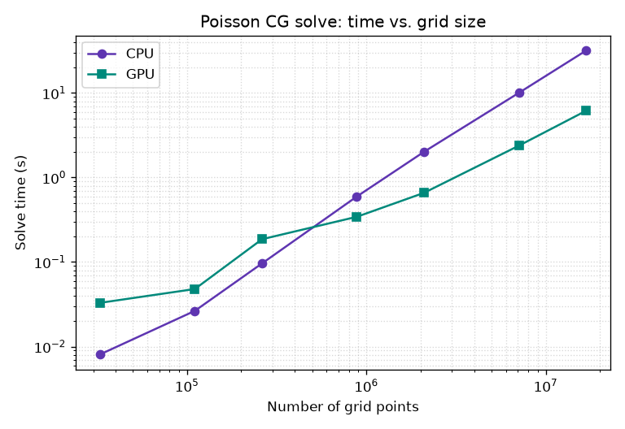

# Benchmark: Poisson

## What is measured

Wall time of the unpreconditioned conjugate-gradient solve of the
[Poisson example](examples.md#poisson-equation) (`examples/poisson.py`) on 3D
grids of $N^3$ points, as a function of $N$, on one CPU core and on one GPU.
Problem: $-\nabla^2 u = f$ on the periodic unit cube with the smooth
zero-mean right-hand side of the example, the 7-point `LaplaceOperator`, no
preconditioner, relative residual $10^{-6}$. The reported time is the
example's `total_time_seconds` (the CG solve, excluding setup). One
measurement per point.

The per-iteration work is one 7-point stencil apply and a few BLAS-1
operations, $O(N^3)$ with a small, constant number of floating-point
operations per value loaded, so the time per iteration is bounded by memory
bandwidth. Without preconditioner $\kappa = O(h^{-2})$ and CG needs $O(N)$
iterations, so the solve time grows as $O(N^4)$.

Configurations:

- **CPU (1 core)** — one process without MPI. µGrid's kernels are not
  multithreaded, so this uses one core.
- **GPU (1 device)** — one process on one GPU.

## Provenance

!!! info "Run (date not recorded)"
    - **Results:** time vs. grid size (fp64)
    - **Date:** not recorded <!-- TODO: benchmark metadata missing: run timestamp -->
    - **Code version:** not recorded <!-- TODO: benchmark metadata missing: code version (commit) -->
    - **CPU:** Intel(R) Core(TM) Ultra 7 356H (16 logical cores)
    - **GPU:** NVIDIA RTX PRO 500 Blackwell Generation Laptop GPU
    - **Compiler:** not recorded <!-- TODO: benchmark metadata missing: compiler and version -->
    - **Libraries:** not recorded <!-- TODO: benchmark metadata missing: key library versions (FFT backend, Eigen, pybind11, NumPy) -->
    - **MPI:** not recorded <!-- TODO: benchmark metadata missing: MPI implementation and version -->
    - **GPU runtime:** not recorded <!-- TODO: benchmark metadata missing: CUDA/ROCm version -->
    - **Nodes:** not recorded <!-- TODO: benchmark metadata missing: node count and ranks per node -->

## Commands

Each data point is one invocation of the example, launched by
`examples/benchmark.py` as

```bash
# CPU (1 core)
python examples/poisson.py -n N,N,N -d cpu -i MAXITER
# GPU (1 device)
python examples/poisson.py -n N,N,N -d gpu -i MAXITER
```

with `N` the grid size of the column and `--json-out FILE` added to collect the
result.

`MAXITER` was not recorded for this run. <!-- TODO: benchmark metadata missing: maximum CG iterations (-i) -->

## Results

| Configuration | 32³ (33k) | 48³ (111k) | 64³ (262k) | 96³ (885k) | 128³ (2.1M) | 192³ (7.1M) | 256³ (16.8M) |
|---|---|---|---|---|---|---|---|
| CPU (1 core) | 0.00808 | 0.0264 | 0.0964 | 0.596 | 2.02 | 10 | 31.7 |
| GPU (1 device) | 0.0329 | 0.0479 | 0.186 | 0.343 | 0.659 | 2.38 | 6.15 |

(values are **solve time in seconds**; `OOM` = the run ran out of memory)



## Reproducing

The results shown are not stored in `benchmarks/results.csv`. <!-- TODO: benchmark metadata missing: database rows for these results -->

Data points are stored in `benchmarks/results.csv`. This page is generated by
`examples/benchmark.py`; `--render-only` re-renders it from the database, and
a run without it measures and appends a new dated run (see
`benchmarks/README.md`):

```bash
python examples/benchmark.py --doc-out docs/benchmark.md \
    --plot-out docs/benchmark.png
```
