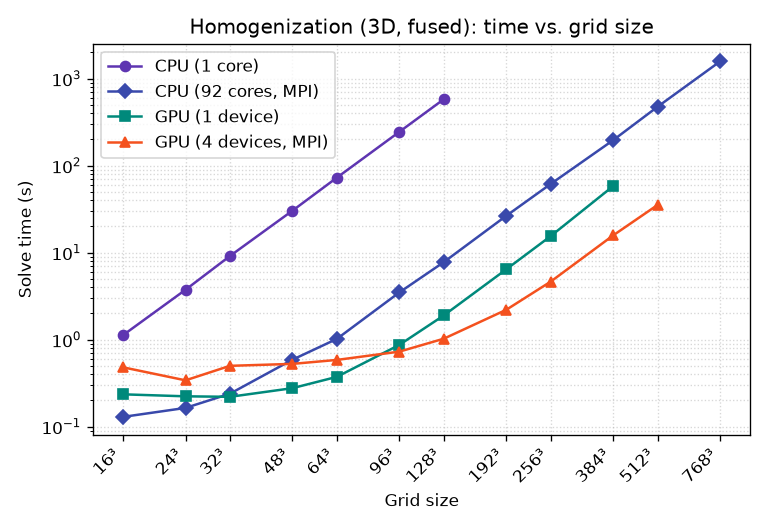

# Benchmark: homogenization

## What is measured

Wall time of the conjugate-gradient solves of the
[homogenization example](examples.md#homogenization) (`examples/homogenization.py`)
on 3D grids of $N^3$ points, as a function of $N$ and of the execution
configuration. Problem: the single spherical inclusion (radius 0.25,
$E_\text{inclusion}/E_\text{matrix} = 10$, $\nu = 0.3$), fused
`IsotropicStiffnessOperator3D` matvec, no preconditioner, the 6 unit load
cases. Each load case runs at most `100` CG iterations (relative
tolerance $10^{-6}$, the example's default); unpreconditioned CG needs more
than that except on the smallest grids, so the work per configuration is
essentially fixed at $6 \times 100$ iterations. The reported time is
the example's `total_time_seconds`: the 6 solves including right-hand-side
assembly and stress averaging, excluding setup. One measurement per point.

All runs are in **double** precision (`fp64`).

Configurations:

- **CPU (1 core)** — one process without MPI. µGrid's kernels are not
  multithreaded, so this uses one core. Swept up to 128³.
- **CPU (92 cores, MPI)** — `mpiexec -n 92`, one rank per core;
  the grid is split into subdomains that exchange ghost layers in every
  matvec.
- **GPU (1 device)** — one process on one GPU.
- **GPU (4 devices, MPI)** — `mpiexec -n 4`, one rank per GPU (assigned round-robin).

Each configuration is swept in $N$ until the first size that runs out of
memory; that size is reported as `OOM` and larger sizes are not attempted.

## Provenance

!!! info "Run 2026-06-30T15:55:33"
    - **Results:** time vs. grid size (fp64)
    - **Code version:** `0.110.0-9-g3cf17e02-dirty` (commit `3cf17e02`, uncommitted changes in the working tree)
    - **CPU:** AMD Instinct MI300A Accelerator (192 logical cores)
    - **GPU:** 4x AMD Instinct MI300A
    - **Compiler:** not recorded <!-- TODO: benchmark metadata missing: compiler and version -->
    - **Libraries:** not recorded <!-- TODO: benchmark metadata missing: key library versions (FFT backend, Eigen, pybind11, NumPy) -->
    - **MPI:** not recorded <!-- TODO: benchmark metadata missing: MPI implementation and version -->
    - **GPU runtime:** not recorded <!-- TODO: benchmark metadata missing: CUDA/ROCm version -->
    - **Nodes:** not recorded <!-- TODO: benchmark metadata missing: node count and ranks per node -->

## Commands

Each data point is one invocation of the example, launched by
`examples/benchmark_homogenization.py` as

```bash
# CPU (1 core)
python examples/homogenization.py -n N,N,N -d cpu -k fused -i 100 --precision double --inclusion-type single
# CPU (92 cores, MPI)
OMPI_MCA_rmaps_base_oversubscribe=1 mpiexec -n 92 python examples/homogenization.py -n N,N,N -d cpu -k fused -i 100 --precision double --inclusion-type single
# GPU (1 device)
python examples/homogenization.py -n N,N,N -d gpu -k fused -i 100 --precision double --inclusion-type single
# GPU (4 devices, MPI)
OMPI_MCA_rmaps_base_oversubscribe=1 mpiexec -n 4 python examples/homogenization.py -n N,N,N -d gpu -k fused -i 100 --precision double --inclusion-type single
```

with `N` the grid size of the column and `--json-out FILE` added to collect the
result.

## Results

| Configuration | 16³ (4k) | 24³ (14k) | 32³ (33k) | 48³ (111k) | 64³ (262k) | 96³ (885k) | 128³ (2.1M) | 192³ (7.1M) | 256³ (16.8M) | 384³ (56.6M) | 512³ (134.2M) | 768³ (453.0M) | 1024³ (1073.7M) | 1536³ (3623.9M) |
|---|---|---|---|---|---|---|---|---|---|---|---|---|---|---|
| CPU (1 core) | 1.07 | 3.67 | 8.63 | 29.1 | 69.4 | 234 | 556 | — | — | — | — | — | — | — |
| CPU (92 cores, MPI) | 0.123 | 0.158 | 0.225 | 0.568 | 0.956 | 3.33 | 7.14 | 24.2 | 56.8 | 194 | 441 | 1.43e+03 | 3.45e+03 | — |
| GPU (1 device) | 0.806 | 3.17 | 20.4 | 125 | 399 | 415 | 418 | 397 | 357 | 346 | 309 | OOM | — | — |
| GPU (4 devices, MPI) | 0.735 | 1.38 | 3.45 | 11.9 | 78.2 | 384 | 413 | 460 | 437 | 445 | 411 | 395 | 398 | OOM |

(values are **solve time in seconds**; `OOM` = the run ran out of memory)



## Reproducing

All data points are stored in `benchmarks/results.csv`. This page is generated
by `examples/benchmark_homogenization.py`; `--render-only` re-renders it from
the database, and a run without it measures and appends a new dated run (see
`benchmarks/README.md`):

```bash
python examples/benchmark_homogenization.py \
    --doc-out docs/benchmark_homogenization.md \
    --plot-out docs/benchmark_homogenization.png
```
