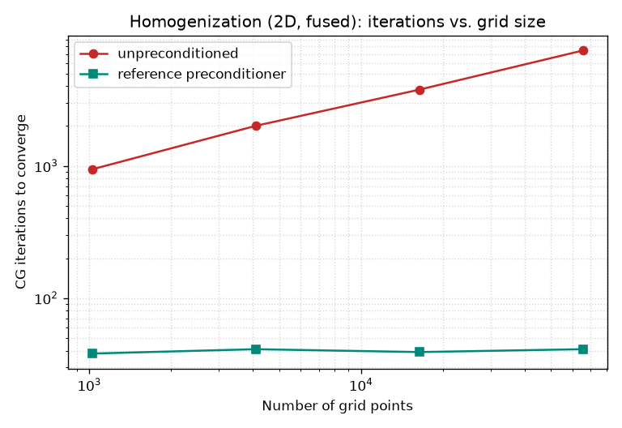
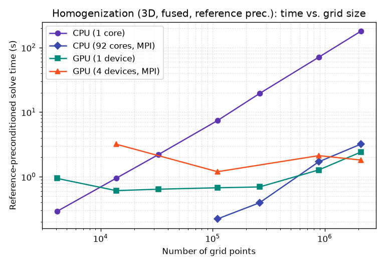

# Benchmark: preconditioner

## What is measured

The effect of the reference-material (Green's-function) preconditioner of
Ladecký et al., Appl. Math. Comput. 446 (2023) 127835 (`-P reference`, see
[Preconditioners](linalg.md#preconditioners)) on the conjugate-gradient solves
of the [homogenization example](examples.md#homogenization)
(`examples/homogenization.py`), compared with no preconditioner (`-P none`).
Problem: $N^3$ grid points, single spherical inclusion (radius 0.25,
$E_\text{inclusion}/E_\text{matrix} = 10$, $\nu = 0.3$), fused
`IsotropicStiffnessOperator3D` matvec in both cases, the 6 unit
load cases, each solved to a relative residual of `1e-06`. Iteration counts
are summed over the load cases; times are the example's `total_time_seconds`
(all solves including right-hand-side assembly and stress averaging,
excluding setup). One measurement per point.

All runs are in **double** precision (`fp64`).

Two studies are reported:

1. **CG iterations vs. grid size**, both preconditioners, on one CPU core. The
   iteration count is a property of the operator and preconditioner, not of
   the device or decomposition. Without preconditioner
   $\kappa(\mathbf{K}) = O(h^{-2})$, so CG needs $O(N)$ iterations; with
   the reference preconditioner $\kappa \le c_\text{max}/c_\text{min}$
   for material data bounded by multiples of the reference, independent of
   $N$.
2. **Reference-preconditioned solve time vs. grid size** for the device and
   MPI configurations of the [homogenization
   benchmark](benchmark_homogenization.md). Each preconditioned iteration
   applies one matvec and one forward/inverse FFT pair, so this measures the
   per-iteration cost of the FFT engine (on the GPU and in the slab MPI
   decomposition) together with the matvec. Each configuration is swept in
   $N$ until the first size that runs out of memory (`OOM`); larger sizes are
   not attempted.

## Provenance

!!! info "Run 2026-06-28T01:19:13"
    - **Results:** CG iterations vs. grid size (fp64)
    - **Code version:** `0.109.0-56-gf1774dbd-dirty` (commit `f1774dbd`, uncommitted changes in the working tree)
    - **CPU:** AMD Instinct MI300A Accelerator (192 logical cores)
    - **GPU:** 4x AMD Instinct MI300A
    - **Compiler:** not recorded <!-- TODO: benchmark metadata missing: compiler and version -->
    - **Libraries:** not recorded <!-- TODO: benchmark metadata missing: key library versions (FFT backend, Eigen, pybind11, NumPy) -->
    - **MPI:** not recorded <!-- TODO: benchmark metadata missing: MPI implementation and version -->
    - **GPU runtime:** not recorded <!-- TODO: benchmark metadata missing: CUDA/ROCm version -->
    - **Nodes:** not recorded <!-- TODO: benchmark metadata missing: node count and ranks per node -->

!!! info "Run 2026-06-29T12:13:40"
    - **Results:** reference solve timing (fp64)
    - **Code version:** `0.110.0-dirty` (commit `f3ef7b08`, uncommitted changes in the working tree)
    - **CPU:** AMD Instinct MI300A Accelerator (192 logical cores)
    - **GPU:** 4x AMD Instinct MI300A
    - **Compiler:** not recorded <!-- TODO: benchmark metadata missing: compiler and version -->
    - **Libraries:** not recorded <!-- TODO: benchmark metadata missing: key library versions (FFT backend, Eigen, pybind11, NumPy) -->
    - **MPI:** not recorded <!-- TODO: benchmark metadata missing: MPI implementation and version -->
    - **GPU runtime:** not recorded <!-- TODO: benchmark metadata missing: CUDA/ROCm version -->
    - **Nodes:** not recorded <!-- TODO: benchmark metadata missing: node count and ranks per node -->

## Commands

Each data point is one invocation of the example, launched by
`examples/benchmark_homogenization_preconditioner.py` as

```bash
# CG iterations vs. grid size (one CPU core)
python examples/homogenization.py -n N,N,N -d cpu -k fused -P {none|reference} -i 20000 --tol 1e-06 --precision double --inclusion-type single
# Reference solve, CPU (1 core)
python examples/homogenization.py -n N,N,N -d cpu -k fused -P reference -i 20000 --tol 1e-06 --precision double --inclusion-type single
# Reference solve, CPU (92 cores, MPI)
OMPI_MCA_rmaps_base_oversubscribe=1 mpiexec -n 92 python examples/homogenization.py -n N,N,N -d cpu -k fused -P reference -i 20000 --tol 1e-06 --precision double --inclusion-type single
# Reference solve, GPU (1 device)
python examples/homogenization.py -n N,N,N -d gpu -k fused -P reference -i 20000 --tol 1e-06 --precision double --inclusion-type single
# Reference solve, GPU (4 devices, MPI)
OMPI_MCA_rmaps_base_oversubscribe=1 mpiexec -n 4 python examples/homogenization.py -n N,N,N -d gpu -k fused -P reference -i 20000 --tol 1e-06 --precision double --inclusion-type single
```

with `N` the grid size of the column and `--json-out FILE` added to collect the
result.

## CG iterations vs. grid size

| Preconditioner | 16³ (4k) | 24³ (14k) | 32³ (33k) | 48³ (111k) | 64³ (262k) |
|---|---|---|---|---|---|
| none | 765 | 1290 | 1593 | 2418 | 3225 |
| reference | 105 | 105 | 105 | 102 | 102 |
| **CPU-core wall-time speedup** | 5× | 9× | 10× | 15× | 19× |

(rows `none`/`reference`: CG iterations summed over the 6 load cases;
last row: wall time without preconditioner ÷ wall time with the reference
preconditioner, one CPU core)



## Reference solve: device and MPI configurations

| Configuration | 16³ (4k) | 24³ (14k) | 32³ (33k) | 48³ (111k) | 64³ (262k) | 96³ (885k) | 128³ (2.1M) | 192³ (7.1M) | 256³ (16.8M) | 384³ (56.6M) | 512³ (134.2M) | 768³ (453.0M) |
|---|---|---|---|---|---|---|---|---|---|---|---|---|
| CPU (1 core) | 0.279 | 0.88 | 2.04 | 7.16 | 17.4 | 60.9 | 153 | — | — | — | — | — |
| CPU (92 cores, MPI) | — | — | — | 0.22 | 0.345 | 1.69 | 3.5 | 12.8 | 22.8 | 86.2 | 195 | — |
| GPU (1 device) | 0.605 | 0.722 | 0.728 | 0.664 | 0.65 | 1.09 | 1.99 | 5.89 | 13.2 | OOM | — | — |
| GPU (4 devices, MPI) | — | 3.07 | — | 1.33 | — | 2.1 | 1.73 | 5.12 | 10.2 | 36.6 | 75.7 | OOM |

(values are **solve time in seconds**, run to convergence; `OOM` = ran out of
memory)



## Reproducing

All data points are stored in `benchmarks/results.csv`. This page is generated
by `examples/benchmark_homogenization_preconditioner.py`; `--render-only`
re-renders it from the database, and a run without it measures and appends a
new dated run (see `benchmarks/README.md`):

```bash
python examples/benchmark_homogenization_preconditioner.py \
    --doc-out docs/benchmark_homogenization_preconditioner.md
```
